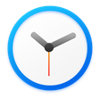
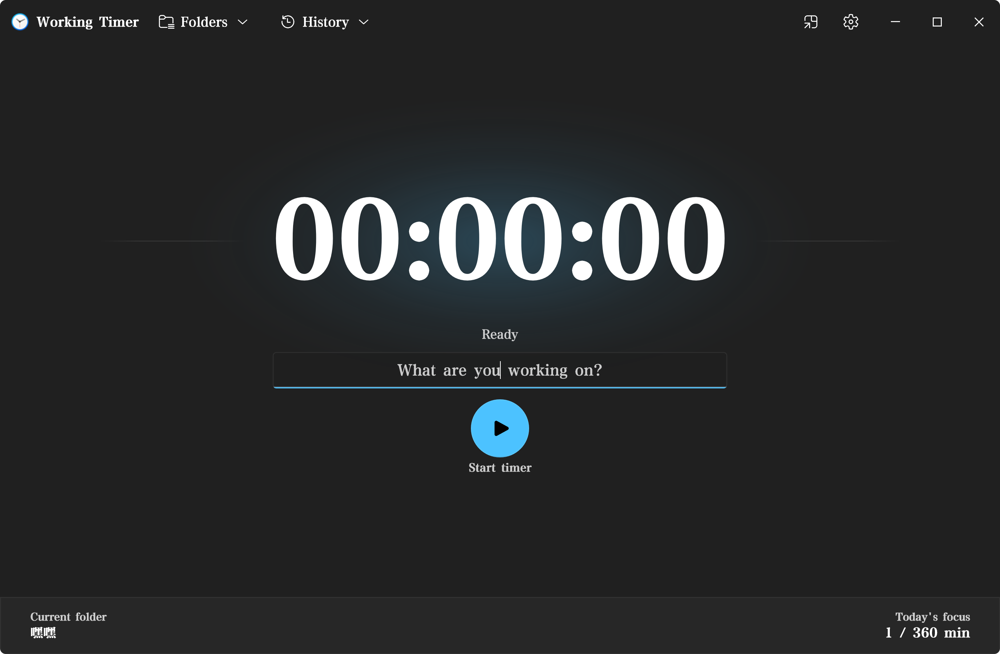
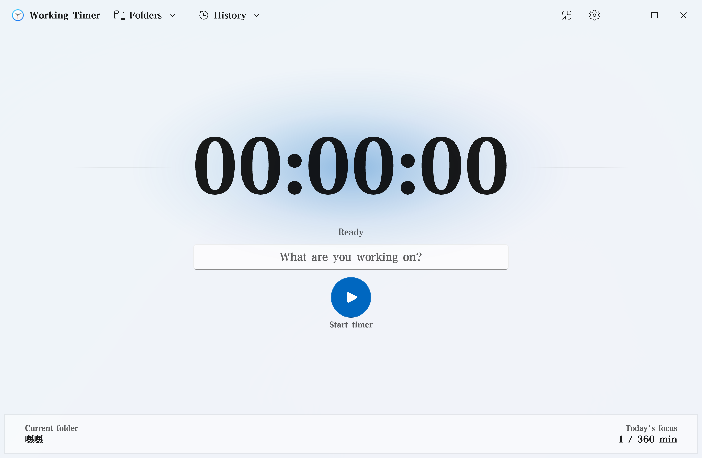
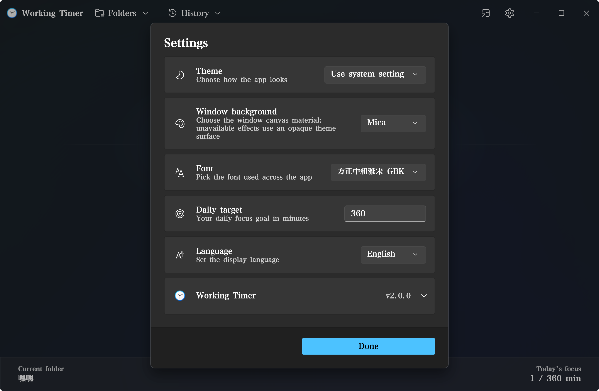
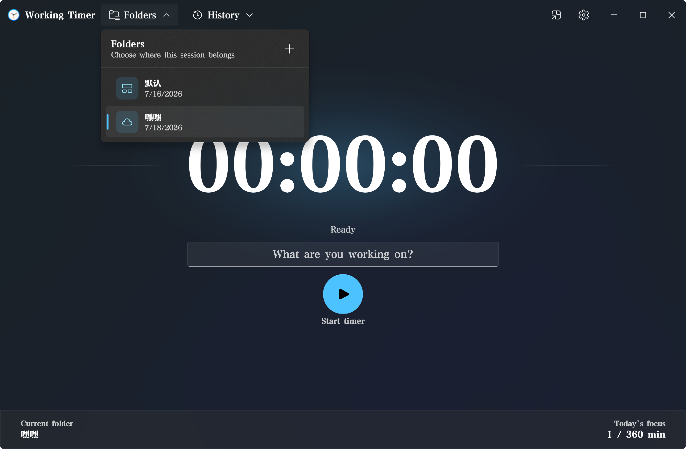
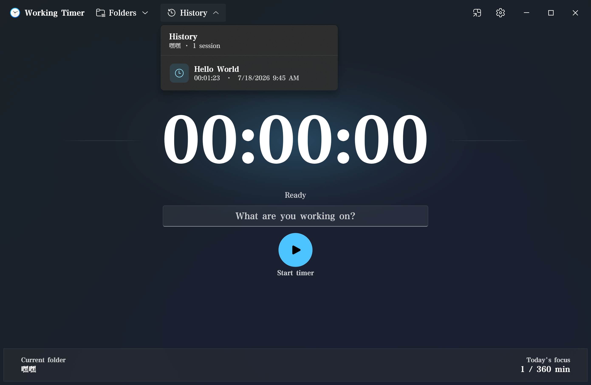
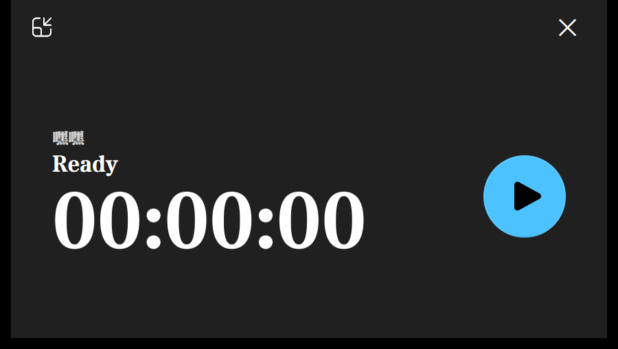

<div align="center">



# Working Timer

**A focused, forward‑counting timer for Windows — rebuilt on [Sprout](https://github.com/Richasy/Sprout) with Fluent Design.**

[%2B-0078D6?logo=windows&logoColor=white)](#-build--run)
[](#-build--run)
[](#-build--run)
[](https://github.com/Richasy/Sprout)
[](LICENSE)

[](https://apps.microsoft.com/detail/9N71W9G714RK)

**English** · [简体中文](README.zh-CN.md)

</div>

<p align="center">
  
</p>

**Working Timer** is the Sprout‑based successor to the archived
[Work‑Timer](https://github.com/Richasy/Work-Timer). It keeps the original count‑up workflow and Microsoft Store
identity, and replaces the old UWP UI and custom style layer with a fully **self‑drawn** Fluent shell — every control,
the timer type, the flyouts and the compact overlay are painted by Sprout on Direct2D / DirectComposition and shipped
as a single **NativeAOT** binary.

> This repository (`Richasy/Rodel.Timer`) is the codebase; **Working Timer** is the product name shown in the app and
> on the Store.

---

## ⬇️ Install

**Working Timer is free on the Microsoft Store** — the recommended way to install it and get automatic updates
(x64 and Arm64, Windows 10 19041+):

<p align="center">
  <a href="https://apps.microsoft.com/detail/9N71W9G714RK">
    
  </a>
</p>

> **Store listing:** https://apps.microsoft.com/detail/9N71W9G714RK

---

## ✨ Features

- ⏱️ **Count‑up timing** — deterministic and monotonic, with no pause state; time only moves forward.
- 🗂️ **Folders & history** — group sessions into folders and browse a per‑folder history, right from the title bar.
- 🎯 **Daily target** — set a daily focus goal in minutes and watch *Today's focus* climb toward it.
- 🎨 **Themes & materials** — System / Light / Dark, and five window canvases (Mica, Mica Alt, Acrylic, Acrylic Thin,
  Liquid Glass Wallpaper).
- 🔤 **Fonts** — pick any installed font for the whole app.
- 🌐 **Live localization** — English and Chinese (Simplified & Traditional), switched instantly with no restart.
- 🪟 **Compact overlay** — collapse to a small, always‑on‑top timer while you work.
- ♿ **Accessible by design** — stable UI Automation ids, accessible names and descriptions, keyboard access keys, and
  transactional screen‑reader announcements.
- 🔒 **Safe upgrade** — a one‑time, fail‑safe import of your existing Work‑Timer folders, history and settings.

---

## 📸 Screenshots

<table>
  <tr>
    <td width="50%">
      <br/>
      <sub><b>Light theme</b> — the shell follows the system, light or dark, live.</sub>
    </td>
    <td width="50%">
      <br/>
      <sub><b>Settings</b> — theme, window material, font, daily target, language, and About.</sub>
    </td>
  </tr>
  <tr>
    <td width="50%">
      <br/>
      <sub><b>Folders</b> — choose where the current session belongs.</sub>
    </td>
    <td width="50%">
      <br/>
      <sub><b>History</b> — per‑folder sessions with duration and time.</sub>
    </td>
  </tr>
  <tr>
    <td colspan="2" align="center">
      <br/>
      <sub><b>Compact overlay</b> — a small, always‑on‑top timer.</sub>
    </td>
  </tr>
</table>

---

## 🏗️ Built with Sprout

Working Timer is a showcase app for **[Sprout](https://github.com/Richasy/Sprout)**, an experimental self‑drawn,
compile‑time‑reconciled, GPU‑rendered Windows UI framework. The code is split into UI‑independent layers:

```text
src/
  Rodel.Timer/               Sprout app shell, Fluent UI, MSIX identity, Windows legacy‑data adapter
  Rodel.Timer.Core/          UI‑independent domain: timing, folders, history, persistence, migration
  Rodel.Timer.Presentation/  Reactive application state and UI‑independent presentation policy
tests/
  Rodel.Timer.Core.Tests/
  Rodel.Timer.Tests/
```

- **`Rodel.Timer.Core`** owns the domain — monotonic timing, the folder/history model with explicit invariants,
  NativeAOT‑safe versioned JSON written with atomic replacement, and the legacy importer.
- **`Rodel.Timer.Presentation`** holds reactive UI state, independent of any specific control.
- **`Rodel.Timer`** is the Sprout shell — the responsive Fluent surface, the title‑bar Folders/History flyouts, the
  open‑canvas workspace, the compact overlay, and the Windows/MSIX glue.

---

## 🚀 Build & run

> **Sprout feed access is required.** `NuGet.config` resolves `Sprout*` packages from the authenticated
> [Sprout Azure Artifacts feed](https://pkgs.dev.azure.com/zrichasy/_packaging/sprout/nuget/v3/index.json).
> Configure its Packaging Read credential in your user-level NuGet configuration using the source name `sprout`.
> Credentials belong outside this repository. The complete package-set version is pinned in `Directory.Packages.props`;
> a local Sprout checkout is unnecessary.
>
> **Just want to use the app?** Install it free from the
> **[Microsoft Store](https://apps.microsoft.com/detail/9N71W9G714RK)** — no build required.

With feed access configured, build with the **.NET 10 SDK** on Windows 10 (19041)+:

```pwsh
dotnet build   Rodel.Timer.slnx
dotnet test    Rodel.Timer.slnx
dotnet publish src\Rodel.Timer\Rodel.Timer.csproj -c Release -r win-x64
```

`dotnet publish` emits the NativeAOT executable and a signed MSIX package under
`artifacts/bin/Rodel.Timer/Release/.../publish`.

See [code style](docs/code-style.md) and the [Sprout upgrade review](docs/sprout-upgrade-review.md) for authoring
conventions, compatibility decisions, and validation limits.

For a Microsoft Store upload, place the product's `Package.StoreAssociation.xml` beside
`src\Rodel.Timer\Rodel.Timer.csproj` (the association file is ignored by Git), then run:

```pwsh
dotnet msbuild src\Rodel.Timer\Rodel.Timer.csproj -restore -t:SproutCreateRelease `
  -p:Configuration=Release -p:SproutPackageDistribution=Store `
  '-p:SproutPackageRids=win-x64|win-arm64'
```

This produces one unsigned `.msixupload` containing the x64/Arm64 bundle and matching NativeAOT symbols.
The package version comes from `SproutAppxVersion`; Microsoft signs the package after certification.

---

## 📄 License

Working Timer is open source under the [MIT License](LICENSE).

---

## 🙏 Acknowledgements

- Built on **[Sprout](https://github.com/Richasy/Sprout)** — the self‑drawn Windows UI framework.
- Succeeds **[Work‑Timer](https://github.com/Richasy/Work-Timer)** — the original UWP application.
